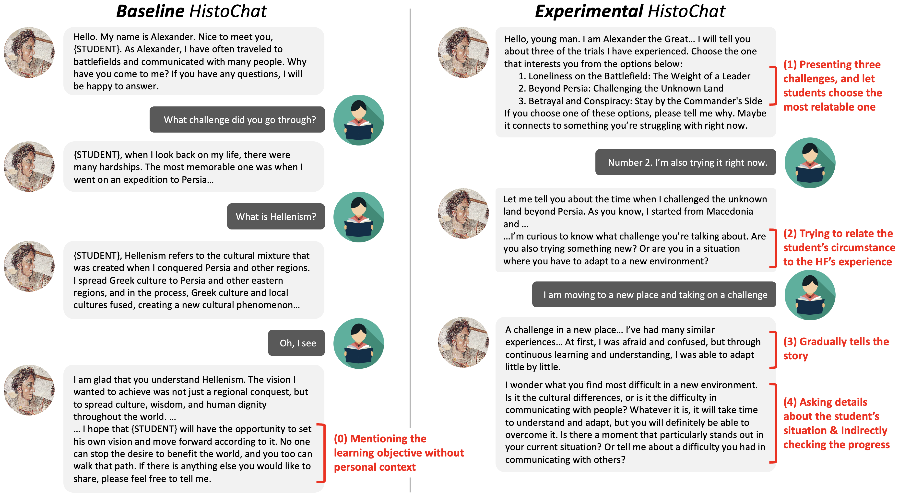

# HistoChat

HistoChat lets middle school students talk with LLM-based historical personas, such as Napoleon or Alexander the Great, as part of a history lesson. It has two versions that differ only in how the model is prompted: Baseline HistoChat answers the student's questions as they come, and Experimental HistoChat leads the conversation toward a learning objective.

Demo: https://histochat.vercel.app



## Paper

Yeon Soo Kim\*, Hyun Seung Moon\*, Sangsu Lee, and Tak Yeon Lee. 2025. "HistoChat": Leveraging AI-Driven Historical Personas for Personalized and Engaging Middle School History Education. *Proc. ACM Hum.-Comput. Interact.* 9, 7, Article CSCW353 (CSCW 2025). https://doi.org/10.1145/3757534

\* Equal contribution. All authors are at KAIST.

The design of the two versions came from a formative study with three teachers and eight middle school students. The main study compared the two versions with 25 middle school students in a within-subjects design.

## How it works

- The React front end (Vite) shows the two versions side by side. The student enters a name and picks a historical figure, then chats with each version in its own panel.
- The browser posts to `/api/chat`, a serverless function (`api/chat.js`) that builds the prompts on the server and calls the OpenAI Chat Completions API with `gpt-4o` (temperature 0.9). The OpenAI key never reaches the browser.
- Baseline (`api/_lib/gptBaseline.js`) keeps the figure's era-appropriate voice and answers what the student asks.
- Experimental (`api/_lib/gptAdvanced.js`) adds a learning objective. On the first turn it offers three adversities the figure faced, with attention-grabbing titles. On later turns it relates the chosen story to the student's own interests and concerns, tells it step by step with dates, places and people, and asks questions to check understanding.
- Both versions support English and Korean. Earlier turns are sent back with each request as conversation history.

## Run locally

Requirements: Node.js and an OpenAI API key.

```bash
git clone https://github.com/Able0401/Histochat.git
cd Histochat
npm install
cp .env.example .env    # set OPENAI_API_KEY
```

`npm run dev` starts only the Vite front end; it does not serve `/api/chat`. To run the front end and the serverless function together, use the Vercel CLI:

```bash
npx vercel dev
```

`npm run build` writes the static site to `dist/`. The live demo is deployed on Vercel, with `OPENAI_API_KEY` set as an environment variable of the project. `firebase.json` only redirects the old Firebase URL (histochat-bbf8e.web.app) to the Vercel deployment.

## Repository layout

```
api/chat.js               serverless endpoint: validates the request, picks the version
api/_lib/gptBaseline.js   Baseline prompts and model call
api/_lib/gptAdvanced.js   Experimental prompts and model call
src/App.jsx               page, side-by-side chat panels, EN/KO toggle
src/components/           message input
src/api/chat.js           browser client for /api/chat
src/api/firebase*.js      Firestore setup from the study version; not imported by the current app
src/data/                 paper PDF and figure
public/                   static assets (teaser image, walkthrough figure, favicon)
vercel.json               SPA rewrite that leaves /api/* to the function
firebase.json             redirect from the old Firebase Hosting URL
```

## Citation

```bibtex
@article{kim2025histochat,
  title   = {"HistoChat": Leveraging AI-Driven Historical Personas for Personalized and Engaging Middle School History Education},
  author  = {Kim, Yeon Soo and Moon, Hyun Seung and Lee, Sangsu and Lee, Tak Yeon},
  journal = {Proceedings of the ACM on Human-Computer Interaction},
  volume  = {9},
  number  = {7},
  pages   = {CSCW353},
  year    = {2025},
  doi     = {10.1145/3757534},
  note    = {Yeon Soo Kim and Hyun Seung Moon contributed equally}
}
```

## License

Code is released under the MIT License (see `LICENSE`). The paper is available from the ACM Digital Library under its own terms.

## Contact

- Yeon Soo Kim: ykim18@kaist.ac.kr
- Hyun Seung Moon: mzes0401@kaist.ac.kr
- Tak Yeon Lee: takyeonlee@kaist.ac.kr
